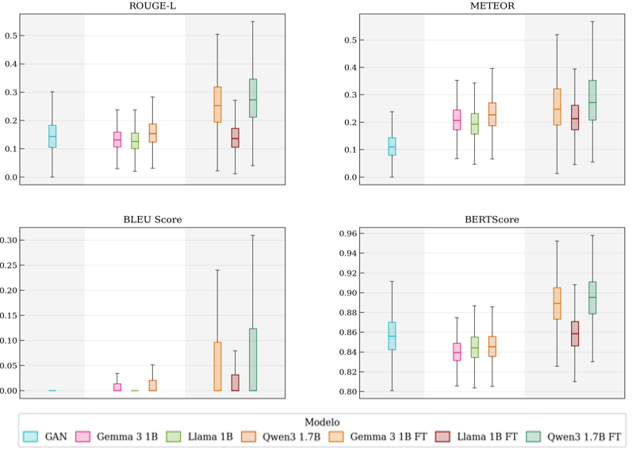
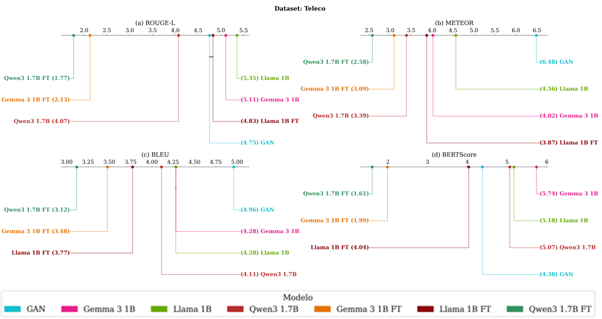
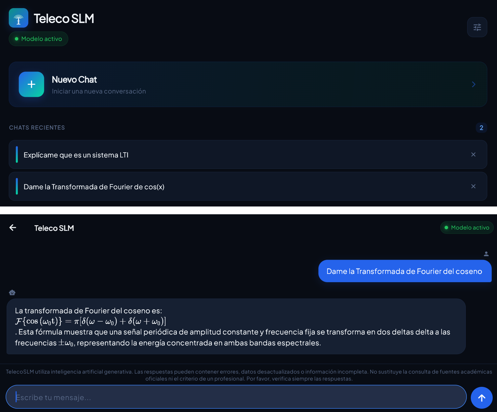

**English** · [Español](README.md)

# TelecoSLM — Design and implementation of a domain-specific generative application for explaining telecommunications content

[](LICENSE)
[](https://play.google.com/store/apps/details?id=com.telecoslm.app)
[](https://huggingface.co/arturofierrop/qwen-3-1.7B-teleco-slm-GGUF)

Final Degree Project in Telecommunication Systems Engineering (Universidad CEU San Pablo, Madrid). **Graded with distinction (Matrícula de Honor).** Finalist among the top 10 projects at the Mondragón Awards.

This project compares LLMs, SLMs, Mini-SLMs, fine-tuned models and a generative GAN on text generation tasks, evaluated over four datasets: WebNLG, ToTTo, KELM and a purpose-built Spanish corpus from the telecommunications domain (*Teleco*, ~24,680 Q&A pairs). The end result is **TelecoSLM**, a Flutter app that runs the selected model (Qwen3 1.7B FT, Q4_K_M GGUF) fully offline on Android and Windows.

## Why

A 70B LLM needs an external API, a connection and a cost per query. In this study, LLMs cost between $1.15 and $10.27 per evaluated corpus (five times more than SLMs), with latencies of 1.4–2.4 s per row and emissions of 333 to 5,127 grams of CO₂ per dataset. A 1.7B model fine-tuned on a domain corpus runs on the device itself: no network, no marginal cost per query, and no data leaving the machine.

The question this work asks is how much quality is lost when scaling down. The answer: far less than expected, and in a specific domain, none.

## Results

### Prior validation of need

Survey of 220 participants on their willingness to use a specialised AI tool to support study: **86.4%** agreed or strongly agreed (87.1% among the subgroup of bachelor's and master's students, n = 178).

### Group 1 — LLM vs SLM vs Mini-SLM on generic corpora

The size hierarchy exists, but it is far narrower than expected. ROUGE-L difference between the best LLM and the best SLM:

| Dataset | Best LLM | Best SLM | Difference |
|---------|----------|----------|------------|
| WebNLG  | 0.540    | 0.528    | 0.012      |
| ToTTo   | 0.505    | 0.499    | 0.005      |
| KELM    | 0.331    | 0.326    | 0.005      |

On BERTScore over KELM, the mean difference between LLMs and SLMs is **0.0004 points**: effectively zero. In the KELM critical difference diagram, DeepSeek (rank 4.76), Gemma 2 9B (4.78) and Qwen 2.5 72B (4.82) form a block with no significant differences, joined by Gemma 3 1B (4.90) — a 1B model is indistinguishable from a 72B one in semantic similarity over a technical corpus.

On WebNLG, Qwen 3 1.7B reaches a ROUGE-L of 0.536, above several larger SLMs.

**Statistical validation.** The Friedman test is significant across every metric and dataset (p < 0.05). At this sample size the p-value loses informative value, so the main interpretation criterion is the Wilcoxon effect size r over the Nemenyi post-hoc, using Cohen's conventional thresholds:

- LLM vs SLM on ToTTo and KELM: null or small effects (r = 0.01–0.21) across all metrics.
- LLM vs SLM on BERTScore: r = 0.05–0.41, mostly null or small.
- LLM vs Mini-SLM on METEOR over WebNLG: here large effects do appear (r = 0.57–0.69).

In other words, the differences are statistically detectable but mostly irrelevant in practice.

### Group 2 — Impact of fine-tuning on the purpose-built corpus

Over the telecommunications corpus (24,680 pairs, 7,699 observations per model), LoRA fine-tuning inverts the hierarchy:

| Model | ROUGE-L | BERTScore | BLEU |
|-------|---------|-----------|------|
| **Qwen 3 1.7B FT** | **0.286** | **0.895** | **0.069** |
| Gemma 3 1B FT | 0.264 | 0.889 | 0.053 |
| Qwen 3 1.7B base | 0.159 | 0.846 | 0.011 |
| GAN (430M, from scratch) | 0.147 | 0.856 | 0.001 |
| Llama 3.2 1B FT | 0.146 | 0.859 | 0.020 |
| Gemma 3 1B base | 0.135 | 0.840 | 0.008 |
| Llama 3.2 1B base | 0.132 | 0.845 | 0.009 |

> *BERTScore separates these models far less than ROUGE-L: every model falls within a 0.055 band (0.840–0.895), while ROUGE-L spans more than a factor of two (0.132–0.286). Semantic similarity saturates on this corpus; lexical overlap is what discriminates.*



Improvement of Qwen 3 1.7B FT over its own base model: **ROUGE-L +80.5%** (0.159 → 0.286), **BLEU +531%** (0.011 → 0.069), **BERTScore +5.8%** (0.846 → 0.895). The mean BERTScore gap between fine-tuned models and their bases is 0.037 points, larger than the gap observed between LLMs and SLMs on generic corpora.



**Statistical validation.** Nemenyi post-hoc: 20 of 21 pairs significant on ROUGE-L and 21 of 21 on METEOR and BERTScore. Effects of the fine-tuned models against the GAN are large (r = 0.79–0.83). Fine-tuning was also checked not to degrade out-of-domain generalisation: comparing base Mini-SLMs with their fine-tuned versions on KELM, effect sizes are null or small (r < 0.3).

### On the GAN

The GAN trained from scratch (conditional SeqGAN with Gumbel-Softmax, ~430M parameters) beats the base Gemma and Llama Mini-SLMs on ROUGE-L (0.147 against 0.135 and 0.132) and is the most efficient option in the study: $0 inference cost and 2.6 grams of CO₂ against the 15–34 grams of the fine-tuned models.

Its BLEU, however, is effectively zero (0.001), reflecting the noise Gumbel-Softmax introduces into the gradient and an unfavourable parameter-to-data ratio (430M parameters over 17,000 training pairs, against Mini-SLMs pre-trained on trillions of tokens). That lack of lexical precision rules it out for structured, query-oriented generation.

### Deployed model

**Qwen 3 1.7B FT**, quantised to Q4_K_M in GGUF format (from 3.4 GB in fp16 down to 1.1 GB). Performance measured in the application:

| Metric | Windows (Intel Core i5) | Android (Galaxy A70) |
|--------|-------------------------|----------------------|
| Time to first token | 2,384 ms | 28,896 ms |
| Total response time | 10.20 s | 79.5 s |
| Generation speed | 9.6 tok/s | 1.48 tok/s |
| RAM usage | 13.0% | 7.5% |

### User validation

Beta distributed to 12 Telecommunications Engineering students over 14 days, GDPR-compliant (EU 2016/679):

| Criterion | Score (1-5) |
|-----------|-------------|
| Usefulness as study support | 4.7 |
| Ease of use | 4.4 |
| Overall rating | 4.4 |
| Answer quality | 4.2 |
| Language naturalness | 4.1 |

88% would recommend the application.

## Repository structure

```
TelecoSLM/
├── LLM/                        # Inference pipeline for LLMs (+70B params)
├── SLM/                        # Inference pipeline for SLMs (~7-14B params)
├── mini-SLM/                   # Inference pipeline for Mini-SLMs (~1-3B params)
├── GAN/                        # Generative GAN pipeline
├── fine-tuning/                # LoRA fine-tuning and adapter merging
├── graficas_y_tests/           # Visualisations and statistical analysis
├── app_teleco_slm/             # Flutter app (Android + Windows)
├── base_teleco/                # Telecommunications dataset (~24,680 Q&A pairs)
├── base_kelm/                  # KELM dataset filtered by STEM topic
├── splits/                     # train/val/test splits by subtopic
├── docs/                       # App screenshots and result charts
├── Manual de Usuario - TelecoSLM.pdf
├── requirements.txt            # Python dependencies
├── .env.example                # Environment variable template
├── .gitignore
├── LICENSE
├── README.md                   # English
└── README.es.md                # Spanish
```

## Requirements and installation

- Python 3.11
- (Optional, for fine-tuning and the GAN) NVIDIA GPU with CUDA
- Flutter / Dart (only to build the app)

Install Python dependencies:

```bash
pip install -r requirements.txt
```

## Environment variables

The API inference pipelines read keys from the following environment variables (they are not written in the code). See `.env.example` for the template:

| Variable | Required for |
|----------|--------------|
| `OPENROUTER_API_KEY` | Inference via OpenRouter (LLM, SLM, Mini-SLM) |
| `TOGETHER_API_KEY`   | Inference via Together AI (Mini-SLM and fine-tuned models) |
| `HF_TOKEN`           | Downloading private Hugging Face models (fine-tuning) |

On Windows (PowerShell), persistently:

```powershell
setx OPENROUTER_API_KEY "your_key"
setx TOGETHER_API_KEY "your_key"
setx HF_TOKEN "your_token"
```

After using `setx` you need to open a new terminal. To set them for the current session only: `$env:OPENROUTER_API_KEY="your_key"` (PowerShell) or `set OPENROUTER_API_KEY=your_key` (CMD).

On Linux / macOS:

```bash
export OPENROUTER_API_KEY="your_key"
export TOGETHER_API_KEY="your_key"
export HF_TOKEN="your_token"
```

## Usage

The project has two independent experimental groups that can be run separately:

- **Group 1** — LLM vs SLM vs Mini-SLM on generic datasets (WebNLG, ToTTo, KELM).
- **Group 2** — base Mini-SLM vs fine-tuned Mini-SLM vs GAN on the Teleco dataset.

### Step 1 — Generate splits (Group 2 only)

```bash
python splits/hacer_splits.py
```

Generates train/val/test splits by subtopic to avoid data leakage. Only needed for experiments on the Teleco dataset.

### Step 2 — Inference

**Group 1** — Generic datasets (WebNLG, ToTTo, KELM):

```bash
python LLM/pipelineLLM.py --dataset totto --model deepseek
python SLM/pipelineSLM.py --dataset webnlg --model llama
python mini-SLM/pipelineminiSLM.py --dataset kelm --model qwen --evaluar
```

**Group 2** — Teleco dataset:

```bash
python SLM/pipelineSLMbbdd.py --model llama
python mini-SLM/pipelineminiSLMbbdd.py --model qwen --evaluar
```

### Step 3 — Training from scratch (Group 2 only)

```bash
# Generative GAN
python GAN/pipeline_gan.py --epochs 100

# LoRA fine-tuning of the three Mini-SLMs
python fine-tuning/pipeline_finetuning.py --dataset all

# Merge LoRA adapters with base models
python fine-tuning/fusionar_lora.py
```

### Step 4 — Metrics and analysis

```bash
python graficas_y_tests/calcula_metricas.py --input-dir resultados
python graficas_y_tests/posthoc.py --input-dir resultados
```

The remaining scripts in `graficas_y_tests/` (boxplots, violin plots, bar plots, Q-Q plots, bootstrap, ranking, distribution and timing charts) follow the same pattern and accept `--input-dir`. Run `--help` on each one.

### Flag reference by script

| Script | Main flags |
|--------|------------|
| `LLM/pipelineLLM.py` | `--dataset` `--model` `--limit` `--fix` |
| `SLM/pipelineSLM.py` | `--dataset` `--model` `--limit` `--fix` `--all` |
| `SLM/pipelineSLMbbdd.py` | `--model` `--limit` `--fix` `--csv` |
| `mini-SLM/pipelineminiSLM.py` | `--dataset` `--model` `--limit` `--evaluar` `--fix` `--all` |
| `mini-SLM/pipelineminiSLMbbdd.py` | `--model` `--limit` `--evaluar` `--fix` `--csv` `--split` |
| `GAN/pipeline_gan.py` | `--csv` `--epochs` `--modo` `--vocab-size` |
| `GAN/gan_teleco_v3.py` | `--modo` `--epochs` `--generar` `--evaluar` `--pregunta` `--csv` `--splits-json` `--vocab-size` `--batch-size` |
| `fine-tuning/pipeline_finetuning.py` | `--csv` `--dataset` `--skip` `--solo` |
| `fine-tuning/fusionar_lora.py` | *(no arguments)* |

All scripts accept `--help`.

`--fix` reprocesses only the rows that errored. `--all` runs every model × dataset combination. `--evaluar` computes metrics after inference (ROUGE, METEOR, BLEU, BERTScore). `--limit N` processes only N rows (useful for quick tests).

## LLM/

Inference pipeline for large models (DeepSeek-V3, Llama 3.3 70B, Qwen 2.5 72B) via API (OpenRouter / Together AI) over the three generic datasets (WebNLG, ToTTo, KELM).

## SLM/

Inference pipeline for mid-sized models (Gemma 2 9B, Llama 3.2 3B, Qwen 2.5 7B) via API (OpenRouter / Together AI) over the three generic datasets and the Telecommunications dataset.

## mini-SLM/

Inference pipeline for small models (Gemma 3 1B, Llama 3.2 1B, Qwen 3 1.7B) via API (OpenRouter / Together AI) over the three generic datasets and the Telecommunications dataset. Includes versions with `<think>` tag cleaning for Qwen3 1.7B.

## GAN/

Full pipeline for the generative text GAN (Conditional SeqGAN with Gumbel-Softmax, ~430M params). Includes the training script, inference over the Telecommunications and KELM datasets, metric computation and learning curve generation.

- `gan_teleco_v3.py` — GAN model and training.
- `pipeline_gan.py` — Full pipeline: trains, evaluates on Teleco and KELM, and generates results.

## fine-tuning/

LoRA fine-tuning of Gemma 3 1B, Llama 3.2 1B and Qwen3 1.7B on the Teleco dataset (LR=2e-4, rank=8, alpha=16, dropout=0.05, 3 epochs). Includes merging LoRA adapters with the base models, inference over the Telecommunications and KELM datasets, and metric computation.

- `pipeline_finetuning.py` — LoRA fine-tuning and inference.
- `fusionar_lora.py` — Merges adapters with base models to export complete models.

## graficas_y_tests/

Chart generation and statistical tests over the pipeline results.

- Boxplots, violin plots, bar plots, critical difference (CD) diagrams, Q-Q plots and inference timing charts.
- Friedman tests, Nemenyi post-hoc, Wilcoxon with effect size r and 95% bootstrap confidence intervals.
- Two experimental groups: **Group 1** (LLM vs SLM vs Mini-SLM, WebNLG/ToTTo/KELM) and **Group 2** (base Mini-SLM vs fine-tuned Mini-SLM vs GAN, Teleco).

## app_teleco_slm/

Cross-platform Flutter app for querying telecommunications content offline.



- **Android**: uses `llama_flutter_android` for native GGUF inference.
- **Windows**: uses `llama-server.exe` over local HTTP.
- Thinking-mode token filter with auto-retry.
- Few-shot system prompt tuned for Spanish responses.
- Full Markdown and LaTeX formula rendering.
- Conversation history stored exclusively on the device via SQLite. In local or GGUF mode, no data leaves the machine.

The app is published on Google Play: **[Teleco SLM](https://play.google.com/store/apps/details?id=com.telecoslm.app)**.

The installation and usage guide for the app is in [Manual de Usuario - TelecoSLM.pdf](Manual%20de%20Usuario%20-%20TelecoSLM.pdf).

> **Note:** The model `.gguf` file is not included because of its size. Download it from [Hugging Face](https://huggingface.co/arturofierrop/qwen-3-1.7B-teleco-slm-GGUF).

## base_teleco/

Purpose-built Spanish dataset created from the telecommunications syllabus at Universidad CEU San Pablo (~24,680 Q&A pairs). The train/val/test splits are generated with `splits/hacer_splits.py` (stratified by subject), so that each subtopic falls into a single split and data leakage is avoided.

## base_kelm/

KELM dataset filtered by STEM topic (~60,000 rows). Includes the filtering script `kelm.py`, which selects entries related to computing, telecommunications, electronics, engineering and applied sciences.

## Datasets

| Dataset | Language | Pairs | Description |
|---------|----------|-------|-------------|
| WebNLG | EN | ~13,000 | RDF triples → text |
| ToTTo | EN | ~120,000 | Tables → descriptions |
| KELM | EN | ~60,000 | Knowledge graphs → text (STEM-filtered) |
| Teleco | ES | ~24,680 | CEU Telecommunication Systems Engineering syllabus → Q&A |

## Main technologies

- Python 3.11, PyTorch, Hugging Face Transformers, PEFT, llama.cpp
- Flutter / Dart
- APIs: OpenRouter, Together AI

## Limitations

- **Android latency.** On a Samsung Galaxy A70 with no dedicated accelerator, time to first token is around 28.9 seconds and a full response around 79.5 seconds — outside what a user would consider interactive. Lower-precision quantisations (4-bit or 2-bit) and ARM-specific optimisations are the most immediate line of improvement.
- **Corpus coverage.** The Teleco dataset is built from a single syllabus and has uneven coverage across subjects, which limits generalisation to other degree programmes or to content not covered in that curriculum.
- **Scope of the metrics.** ROUGE-L, METEOR, BLEU and BERTScore capture lexical and semantic overlap against the reference, but do not evaluate factual correctness or technical reasoning. Only human evaluation can reliably cover those dimensions.
- **Compute resources.** Available hardware limited the size of the GAN and made it necessary to rent servers for inference on the large models, which narrows the configuration space explored.

## Future work

Expand the corpus with more questions per topic, explore RAG over the purpose-built corpus to reduce hallucinations, evaluate knowledge distillation from LLMs into fine-tuned Mini-SLMs, and incorporate systematic human evaluation alongside the automatic metrics.

## Author and supervisors

**Author:** Arturo Fierro Pardo
BSc in Telecommunication Systems Engineering, Universidad CEU San Pablo (Madrid).

**Supervisors:** Ana Sanmartín Domenech and Pablo Pérez Tirador.
