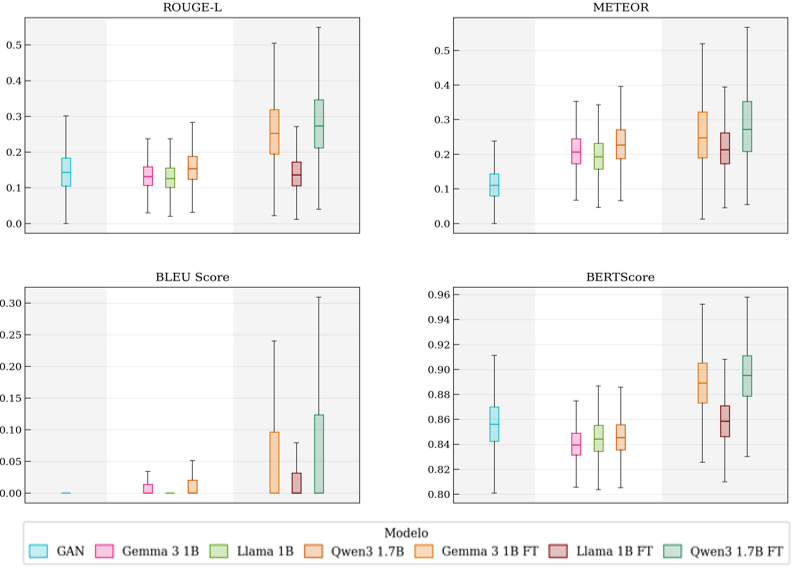
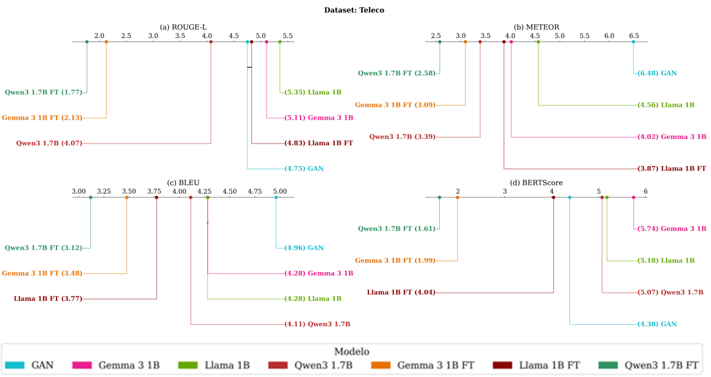
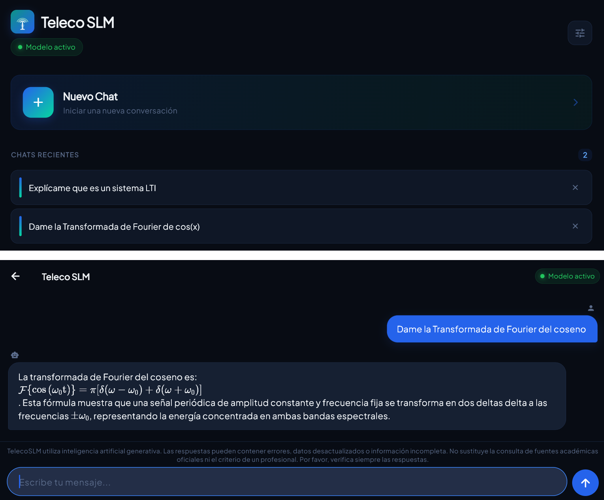

[English](README.en.md) · **Español**

# TelecoSLM — Diseño e implementación de una aplicación generativa de explicación de contenidos de telecomunicaciones de dominio específico

[](https://github.com/ArturoFierroPardo/TelecoSLM/actions/workflows/tests.yml)
[](LICENSE)
[](https://play.google.com/store/apps/details?id=com.telecoslm.app)
[](https://huggingface.co/arturofierrop/qwen-3-1.7B-teleco-slm-GGUF)
[](docs/Memoria_TFG.pdf)
[](https://github.com/ArturoFierroPardo/TelecoSLM/releases/latest)

Trabajo de Fin de Grado en Ingeniería de Sistemas de Telecomunicación (Universidad CEU San Pablo, Madrid). **Calificación: Matrícula de Honor.** Finalista entre los 10 mejores proyectos de los Premios Mondragón.

Este proyecto compara LLMs, SLMs, Mini-SLMs, modelos fine-tuneados y un GAN generativo en tareas de generación de texto, evaluados sobre cuatro datasets: WebNLG, ToTTo, KELM y un corpus propio en español del ámbito de telecomunicaciones (*Teleco*, ~24.680 pares Q&A). El resultado final es **TelecoSLM**, una app Flutter que ejecuta el modelo seleccionado (Qwen3 1.7B FT, Q4_K_M GGUF) de forma completamente offline en Android y Windows.

La investigación completa —marco teórico, diseño experimental, metodología y la totalidad de los resultados y anexos— está en la [memoria del Trabajo de Fin de Grado](docs/Memoria_TFG.pdf).

## Por qué

Un LLM de 70B necesita API externa, conexión y coste por consulta. En este estudio, los LLM costaron entre 1,15 $ y 10,27 $ por corpus evaluado (cinco veces más que los SLM), con latencias de 1,4-2,4 s por fila y emisiones de 333 a 5.127 gramos de CO₂ por dataset. Un modelo de 1,7B ajustado sobre un corpus de dominio se ejecuta en el propio dispositivo: sin red, sin coste marginal por consulta y sin que ningún dato salga del equipo.

La pregunta del trabajo es cuánta calidad se pierde al bajar de escala, y la respuesta es: mucha menos de la esperada, y en dominio específico ninguna.

## Resultados

### Validación previa de necesidad

Encuesta a 220 participantes sobre la disposición a usar una herramienta de IA especializada como apoyo al estudio: el **86,4 %** se mostró de acuerdo o totalmente de acuerdo (87,1 % en el subgrupo de estudiantes de grado y máster, n = 178).

### Grupo 1 — LLM vs SLM vs Mini-SLM sobre corpus genéricos

La jerarquía por tamaño existe, pero es mucho más estrecha de lo esperado. Diferencia en ROUGE-L entre el mejor LLM y el mejor SLM:

| Dataset | Mejor LLM | Mejor SLM | Diferencia |
|---------|-----------|-----------|------------|
| WebNLG  | 0,540     | 0,528     | 0,012      |
| ToTTo   | 0,505     | 0,499     | 0,005      |
| KELM    | 0,331     | 0,326     | 0,005      |

En BERTScore sobre KELM la diferencia media entre LLM y SLM es de **0,0004 puntos**: prácticamente nula. En el diagrama de diferencia crítica de KELM, DeepSeek (rango 4,76), Gemma 2 9B (4,78) y Qwen 2.5 72B (4,82) forman un bloque sin diferencias significativas al que se suma Gemma 3 1B (4,90) — un modelo de 1B es indistinguible de uno de 72B en similitud semántica sobre corpus técnico.

En WebNLG, Qwen 3 1.7B alcanza un ROUGE-L de 0,536, por encima de varios SLM de mayor tamaño.

**Validación estadística.** Test de Friedman significativo en todas las métricas y datasets (p < 0,05). Con muestras de este tamaño el p-valor pierde valor informativo, por lo que el criterio de interpretación principal es el tamaño de efecto r de Wilcoxon sobre el post-hoc de Nemenyi, con los umbrales convencionales de Cohen:

- LLM vs SLM en ToTTo y KELM: efectos nulos o pequeños (r = 0,01 – 0,21) en todas las métricas.
- LLM vs SLM en BERTScore: r = 0,05 – 0,41, mayoritariamente nulos o pequeños.
- LLM vs Mini-SLM en METEOR sobre WebNLG: aquí sí aparecen efectos grandes (r = 0,57 – 0,69).

Es decir, las diferencias son estadísticamente detectables pero en su mayoría irrelevantes en la práctica.

### Grupo 2 — Impacto del fine-tuning sobre el corpus propio

Sobre el corpus de telecomunicaciones (24.680 pares, 7.699 observaciones por modelo), el fine-tuning con LoRA invierte la jerarquía:

| Modelo | ROUGE-L | BERTScore | BLEU |
|--------|---------|-----------|------|
| **Qwen 3 1.7B FT** | **0,286** | **0,895** | **0,069** |
| Gemma 3 1B FT | 0,264 | 0,889 | 0,053 |
| Qwen 3 1.7B base | 0,159 | 0,846 | 0,011 |
| GAN (430M, desde cero) | 0,147 | 0,856 | 0,001 |
| Llama 3.2 1B FT | 0,146 | 0,859 | 0,020 |
| Gemma 3 1B base | 0,135 | 0,840 | 0,008 |
| Llama 3.2 1B base | 0,132 | 0,845 | 0,009 |

> *El BERTScore separa mucho menos que el ROUGE-L: todos los modelos caen en una banda de 0,055 (0,840–0,895), mientras que el ROUGE-L abarca más del doble (0,132–0,286). La similitud semántica satura en este corpus; lo que discrimina es el solapamiento léxico.*



Mejora de Qwen 3 1.7B FT sobre su propio modelo base: **ROUGE-L +80,5 %** (0,159 → 0,286), **BLEU +531 %** (0,011 → 0,069), **BERTScore +5,8 %** (0,846 → 0,895). La brecha media en BERTScore entre los modelos ajustados y sus bases es de 0,037 puntos, mayor que la observada entre LLM y SLM en corpus genéricos.



**Validación estadística.** Post-hoc de Nemenyi: 20 de 21 pares significativos en ROUGE-L y 21 de 21 en METEOR y BERTScore. Los efectos de los modelos ajustados frente a la GAN son grandes (r = 0,79 – 0,83). Se comprobó además que el ajuste no degrada la generalización fuera de dominio: comparando los Mini-SLM base con sus versiones ajustadas sobre KELM, los tamaños de efecto resultan nulos o pequeños (r < 0,3).

### Sobre la GAN

La GAN entrenada desde cero (SeqGAN condicional con Gumbel-Softmax, ~430M parámetros) supera en ROUGE-L a los Mini-SLM base de Gemma y Llama (0,147 frente a 0,135 y 0,132) y es la opción más eficiente del estudio: coste de inferencia 0 $ y 2,6 gramos de CO₂ frente a los 15-34 gramos de los modelos ajustados.

Pero su BLEU es prácticamente nulo (0,001), reflejo del ruido que el Gumbel-Softmax introduce en el gradiente y de un ratio parámetros/datos desfavorable (430M parámetros sobre 17.000 pares de entrenamiento, frente a Mini-SLM preentrenados con billones de tokens). Esa falta de precisión léxica la descarta para generación estructurada orientada a consulta.

### Modelo desplegado

**Qwen 3 1.7B FT**, cuantizado a Q4_K_M en formato GGUF (de 3,4 GB en fp16 a 1,1 GB). Rendimiento medido en la aplicación:

| Métrica | Windows (Intel Core i5) | Android (Galaxy A70) |
|---------|-------------------------|----------------------|
| Tiempo hasta primer token | 2.384 ms | 28.896 ms |
| Tiempo total de respuesta | 10,20 s | 79,5 s |
| Velocidad de generación | 9,6 tok/s | 1,48 tok/s |
| Uso de memoria RAM | 13,0 % | 7,5 % |

### Validación con usuarios

Beta distribuida a 12 estudiantes de Ingeniería de Telecomunicaciones durante 14 días, conforme al RGPD (UE 2016/679):

| Criterio | Puntuación (1-5) |
|----------|------------------|
| Utilidad como apoyo al estudio | 4,7 |
| Facilidad de uso | 4,4 |
| Valoración global | 4,4 |
| Calidad de las respuestas | 4,2 |
| Naturalidad del lenguaje | 4,1 |

El 88 % recomendaría la aplicación.

## Estructura del repositorio

```
TelecoSLM/
├── LLM/                        # Pipeline de inferencia para LLMs (+70B params)
├── SLM/                        # Pipeline de inferencia para SLMs (~7-14B params)
├── mini-SLM/                   # Pipeline de inferencia para Mini-SLMs (~1-3B params)
├── GAN/                        # Pipeline de la GAN generativa
├── fine-tuning/                # Fine-tuning LoRA y fusión de adaptadores
├── graficas_y_tests/           # Visualizaciones y análisis estadístico
├── app_teleco_slm/             # App Flutter (Android + Windows)
├── base_teleco/                # Dataset de Telecomunicaciones (~24.680 pares Q&A)
├── base_kelm/                  # Dataset KELM filtrado por temática STEM
├── splits/                     # Splits train/val/test por subtema
├── docs/                       # Capturas de la app y gráficas de resultados
├── Manual de Usuario - TelecoSLM.pdf
├── requirements.txt            # Dependencias Python
├── .env.example                # Plantilla de variables de entorno
├── .gitignore
├── LICENSE
├── README.md                   # Inglés
└── README.es.md                # Español
```

## Requisitos e instalación

- Python 3.11
- (Opcional, para fine-tuning y GAN) GPU NVIDIA con CUDA
- Flutter / Dart (solo para compilar la app)

Instalación de dependencias de Python:

```bash
pip install -r requirements.txt
```

## Variables de entorno

Los pipelines de inferencia por API leen las claves de las siguientes variables de entorno (no van escritas en el código). Consulta `.env.example` para ver la plantilla:

| Variable | Necesaria para |
|----------|----------------|
| `OPENROUTER_API_KEY` | Inferencia vía OpenRouter (LLM, SLM, Mini-SLM) |
| `TOGETHER_API_KEY`   | Inferencia vía Together AI (Mini-SLM y modelos fine-tuneados) |
| `HF_TOKEN`           | Descarga de modelos privados de Hugging Face (fine-tuning) |

En Windows (PowerShell), de forma persistente:

```powershell
setx OPENROUTER_API_KEY "tu_clave"
setx TOGETHER_API_KEY "tu_clave"
setx HF_TOKEN "tu_token"
```

Tras usar `setx` hay que abrir una terminal nueva. Para definirlas solo en la sesión actual: `$env:OPENROUTER_API_KEY="tu_clave"` (PowerShell) o `set OPENROUTER_API_KEY=tu_clave` (CMD).

En Linux / macOS:

```bash
export OPENROUTER_API_KEY="tu_clave"
export TOGETHER_API_KEY="tu_clave"
export HF_TOKEN="tu_token"
```

## Uso

El proyecto tiene dos grupos experimentales independientes que se pueden ejecutar por separado:

- **Grupo 1** — LLM vs SLM vs Mini-SLM sobre datasets genéricos (WebNLG, ToTTo, KELM).
- **Grupo 2** — Mini-SLM base vs Mini-SLM fine-tuned vs GAN sobre el dataset Teleco.

### Paso 1 — Generar splits (solo Grupo 2)

```bash
python splits/hacer_splits.py
```

Genera los splits train/val/test por subtema para evitar data leakage. Solo necesario para los experimentos sobre el dataset Teleco.

### Paso 2 — Inferencia

**Grupo 1** — Datasets genéricos (WebNLG, ToTTo, KELM):

```bash
python LLM/pipelineLLM.py --dataset totto --model deepseek
python SLM/pipelineSLM.py --dataset webnlg --model llama
python mini-SLM/pipelineminiSLM.py --dataset kelm --model qwen --evaluar
```

**Grupo 2** — Dataset Teleco:

```bash
python SLM/pipelineSLMbbdd.py --model llama
python mini-SLM/pipelineminiSLMbbdd.py --model qwen --evaluar
```

### Paso 3 — Entrenamiento propio (solo Grupo 2)

```bash
# GAN generativa
python GAN/pipeline_gan.py --epochs 100

# Fine-tuning LoRA de los tres Mini-SLMs
python fine-tuning/pipeline_finetuning.py --dataset all

# Fusionar adaptadores LoRA con modelos base
python fine-tuning/fusionar_lora.py
```

### Paso 4 — Métricas y análisis

```bash
python graficas_y_tests/calcula_metricas.py --input-dir resultados
python graficas_y_tests/posthoc.py --input-dir resultados
```

El resto de scripts de `graficas_y_tests/` (boxplots, violin plots, bar plots, Q-Q plots, bootstrap, ranking, gráficas de distribución y de tiempos) siguen el mismo patrón y admiten `--input-dir`. Consulta `--help` en cada uno.

### Referencia de flags por script

| Script | Flags principales |
|--------|-------------------|
| `LLM/pipelineLLM.py` | `--dataset` `--model` `--limit` `--fix` |
| `SLM/pipelineSLM.py` | `--dataset` `--model` `--limit` `--fix` `--all` |
| `SLM/pipelineSLMbbdd.py` | `--model` `--limit` `--fix` `--csv` |
| `mini-SLM/pipelineminiSLM.py` | `--dataset` `--model` `--limit` `--evaluar` `--fix` `--all` |
| `mini-SLM/pipelineminiSLMbbdd.py` | `--model` `--limit` `--evaluar` `--fix` `--csv` `--split` |
| `GAN/pipeline_gan.py` | `--csv` `--epochs` `--modo` `--vocab-size` |
| `GAN/gan_teleco_v3.py` | `--modo` `--epochs` `--generar` `--evaluar` `--pregunta` `--csv` `--splits-json` `--vocab-size` `--batch-size` |
| `fine-tuning/pipeline_finetuning.py` | `--csv` `--dataset` `--skip` `--solo` |
| `fine-tuning/fusionar_lora.py` | *(sin argumentos)* |

Todos los scripts admiten `--help`.

`--fix` reprocesa solo las filas con error. `--all` lanza todas las combinaciones modelo × dataset. `--evaluar` calcula métricas tras la inferencia (ROUGE, METEOR, BLEU, BERTScore). `--limit N` procesa solo N filas (útil para tests rápidos).

## LLM/

Pipeline de inferencia para modelos grandes (DeepSeek-V3, Llama 3.3 70B, Qwen 2.5 72B) vía API (OpenRouter / Together AI) sobre los tres datasets genéricos (WebNLG, ToTTo, KELM).

## SLM/

Pipeline de inferencia para modelos medianos (Gemma 2 9B, Llama 3.2 3B, Qwen 2.5 7B) vía API (OpenRouter / Together AI) sobre los tres datasets genéricos y el dataset de Telecomunicaciones.

## mini-SLM/

Pipeline de inferencia para modelos pequeños (Gemma 3 1B, Llama 3.2 1B, Qwen 3 1.7B) vía API (OpenRouter / Together AI) sobre los tres datasets genéricos y el dataset de Telecomunicaciones. Incluye versiones con limpieza de tags `<think>` para Qwen3 1.7B.

## GAN/

Pipeline completo de la GAN generativa de texto (Conditional SeqGAN con Gumbel-Softmax, ~430M params). Incluye el script de entrenamiento, inferencia sobre dataset de Telecomunicaciones y KELM, cálculo de métricas y generación de curvas de aprendizaje.

- `gan_teleco_v3.py` — Modelo y entrenamiento de la GAN.
- `pipeline_gan.py` — Pipeline completo: entrena, evalúa sobre Teleco y KELM, y genera resultados.

## fine-tuning/

Fine-tuning LoRA de Gemma 3 1B, Llama 3.2 1B y Qwen3 1.7B sobre el dataset Teleco (LR=2e-4, rank=8, alpha=16, dropout=0.05, 3 epochs). Incluye fusión de adaptadores LoRA con los modelos base, inferencia sobre dataset de Telecomunicaciones y KELM, y cálculo de métricas.

- `pipeline_finetuning.py` — Fine-tuning LoRA e inferencia.
- `fusionar_lora.py` — Fusión de adaptadores con modelos base para exportar modelos completos.

## graficas_y_tests/

Generación de gráficas y tests estadísticos sobre los resultados de los pipelines.

- Boxplots, violin plots, bar plots, diagramas de diferencia crítica (CD), Q-Q plots y gráficas de tiempos de inferencia.
- Tests de Friedman, Nemenyi post-hoc, Wilcoxon con tamaño de efecto r e intervalos de confianza bootstrap al 95%.
- Dos grupos experimentales: **Grupo 1** (LLM vs SLM vs Mini-SLM, WebNLG/ToTTo/KELM) y **Grupo 2** (Mini-SLM base vs Mini-SLM fine-tuned vs GAN, Teleco).

## app_teleco_slm/

App Flutter multiplataforma que permite consultar información de telecomunicaciones offline.



- **Android**: usa `llama_flutter_android` para inferencia nativa del GGUF.
- **Windows**: usa `llama-server.exe` vía HTTP local.
- Filtro de tokens de modo thinking con auto-retry.
- System prompt few-shot optimizado para respuestas en español.
- Renderizado completo de Markdown y fórmulas en LaTeX.
- Historial de conversaciones almacenado exclusivamente en el dispositivo mediante SQLite. En modo local o GGUF ningún dato abandona el equipo.

La app está publicada en Google Play: **[Teleco SLM](https://play.google.com/store/apps/details?id=com.telecoslm.app)**.

**Descargas directas.** El APK de Android y el instalador de Windows están en la [última release](https://github.com/ArturoFierroPardo/TelecoSLM/releases/latest), en la sección *Assets*. El instalador de Windows (1,04 GB) incluye el modelo dentro y funciona sin descargas adicionales. El APK requiere Android 8.0 o superior y la app descarga el modelo desde Hugging Face la primera vez que se abre; a partir de ahí funciona offline.

La guía de instalación y uso de la app está en el [manual de usuario](docs/Manual_de_usuario.md).

> **Nota:** El archivo `.gguf` del modelo no está incluido por su tamaño. Para obtenerlo, descárgalo desde [Hugging Face](https://huggingface.co/arturofierrop/qwen-3-1.7B-teleco-slm-GGUF).

## base_teleco/

Dataset propio en español construido a partir del plan de estudios de telecomunicaciones de la Universidad CEU San Pablo (~24.680 pares Q&A). Los splits train/val/test se generan con `splits/hacer_splits.py` (estratificado por asignatura), de modo que cada subtema queda en un único split y se evita el data leakage.

## base_kelm/

Dataset KELM filtrado por temática STEM (~60.000 filas). Incluye el script de filtrado `kelm.py` que selecciona entradas relacionadas con informática, telecomunicaciones, electrónica, ingeniería y ciencias aplicadas.

## Datasets

| Dataset | Idioma | Pares | Descripción |
|---------|--------|-------|-------------|
| WebNLG | EN | ~13.000 | Tripletas RDF → texto |
| ToTTo | EN | ~120.000 | Tablas → descripciones |
| KELM | EN | ~60.000 | Grafos de conocimiento → texto (filtrado STEM) |
| Teleco | ES | ~24.680 | Plan de estudios del Grado en Ingeniería de Sistemas de Telecomunicación CEU → Q&A |

## Tecnologías principales

- Python 3.11, PyTorch, Hugging Face Transformers, PEFT, llama.cpp
- Flutter / Dart
- APIs: OpenRouter, Together AI

## Limitaciones

- **Latencia en Android.** En un Samsung Galaxy A70 sin acelerador dedicado, el tiempo hasta el primer token ronda los 28,9 segundos y la respuesta completa los 79,5 segundos, valores fuera del rango de lo que un usuario consideraría interactivo. Cuantizaciones de menor precisión (4-bit o 2-bit) y optimizaciones para arquitecturas ARM son la línea de mejora más inmediata.
- **Cobertura del corpus.** El dataset Teleco está construido a partir de un único plan de estudios y tiene cobertura desigual entre asignaturas, lo que limita la generalización a otros programas de grado o a contenidos no cubiertos en ese temario.
- **Alcance de las métricas.** ROUGE-L, METEOR, BLEU y BERTScore capturan solapamiento léxico y semántico frente a la referencia, pero no evalúan corrección factual ni razonamiento técnico. Esas dimensiones solo puede cubrirlas de forma fiable la evaluación humana.
- **Recursos de cómputo.** El hardware disponible limitó el tamaño de la GAN y obligó a alquilar servidores para la inferencia de los modelos grandes, lo que acota el espacio de configuraciones exploradas.

## Trabajo futuro

Ampliar el corpus con más preguntas por temática, explorar RAG sobre el corpus propio para reducir alucinaciones, evaluar técnicas de destilación del conocimiento desde LLM hacia Mini-SLM ajustados, e incorporar evaluación humana sistemática como complemento a las métricas automáticas.

## Autor y tutores

**Autor:** Arturo Fierro Pardo
Grado en Ingeniería de Sistemas de Telecomunicación, Universidad CEU San Pablo (Madrid).

**Tutores:** Ana Sanmartín Domenech y Pablo Pérez Tirador.
